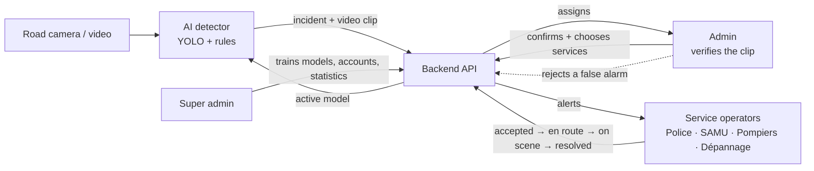
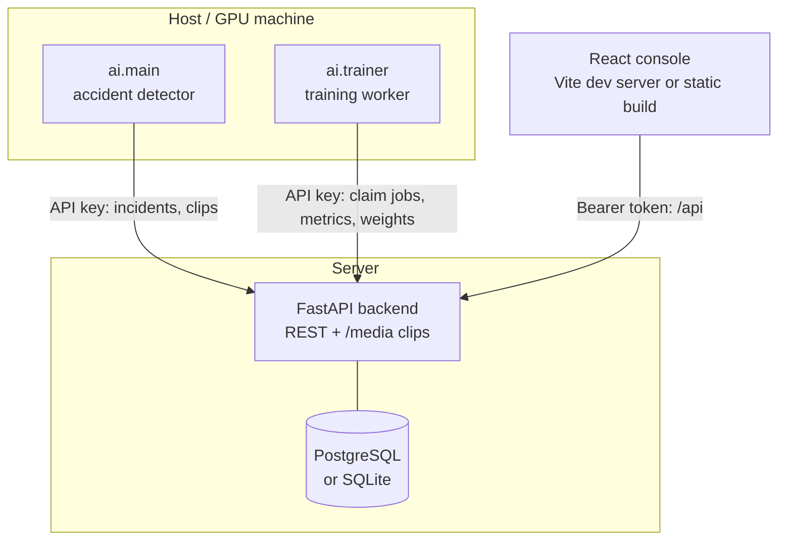

# Nexora SafeRoad

> AI-assisted road accident detection and emergency response.

Nexora SafeRoad watches road cameras with an AI model, detects possible accidents, estimates how
serious they are, and puts them in front of a human operator with the evidence: a short video
clip, what the AI saw, the location on a map and the services it recommends. The operator confirms
the accident (or rejects a false alarm) and alerts the right services — Police, Ambulance (SAMU),
Firefighters (Pompiers), Road assistance (Dépannage) — who follow the intervention in their own
console until it is resolved.

**The AI suggests; a person always decides.** No alert leaves the platform without an operator
confirming the accident first.

SafeCity / DataCity project — EFREI 2026.

---

## Contents

- [How it works](#how-it-works)
- [Roles](#roles)
- [Features](#features)
- [Architecture](#architecture)
- [Quick start](#quick-start)
- [Demo accounts](#demo-accounts)
- [Incident and alert lifecycle](#incident-and-alert-lifecycle)
- [Rules the platform enforces](#rules-the-platform-enforces)
- [Project structure](#project-structure)
- [Tests](#tests)
- [Technology](#technology)
- [Scope and limits](#scope-and-limits)
- [Credits and license](#credits-and-license)

Detailed documentation: [backend](backend/README.md) · [frontend](frontend/README.md) · [AI](ai/README.md).

---

## How it works



1. **Detection.** The AI pipeline reads a video file, webcam or stream. A YOLO model finds vehicles
   and people; an accident model looks for accidents, fire and overturned vehicles. An accident
   counts only when it is seen in several consecutive frames.
2. **Incident.** The pipeline estimates the severity (fixed rules on what it counted), records the
   footage from a few seconds before to a few seconds after the detection, and sends both to the
   backend.
3. **Assignment.** The backend gives the incident to an available admin straight away — most
   severe first when several are waiting. The incident is locked to that admin.
4. **Verification.** The admin watches the clip next to the AI assessment and the map, then
   confirms a real accident or rejects a false alarm.
5. **Response.** For a confirmed accident the admin reviews the services the AI recommends (with
   the nearest station for each) and sends the alert.
6. **Intervention.** Operators of each alerted service see the alert; the first available one
   accepts it and reports progress until it is resolved. The incident is resolved when every
   service has finished.
7. **Learning.** Rejected false alarms and confirmed accidents become training material. The
   super admin trains new models on uploaded datasets plus this feedback, compares them and
   chooses the one the detector uses.

## Roles

| Role | Works in | Can do |
|---|---|---|
| **Super admin** | `/superadmin` | Platform overview and statistics, every incident (read only), history and map, **AI training** (datasets, training jobs, model activation, review of AI predictions), **accounts** (create admins, service operators and super admins). Never assigned incidents. |
| **Admin** | `/admin` | Incident queue and review workspace: verify the clip, confirm or reject, choose services and stations, send the alert. Pause/resume availability. Incidents list, map, history. |
| **Police, Ambulance, Firefighters, Road assistance** | `/operator` | Alerts for their own service: accept one, then *en route → on scene → resolved*. Incidents their service was alerted to, and the map. |

Every role signs in on the same page with a username and password. The server detects the stored role and opens the matching dashboard automatically.

## Features

- **One-screen review**: incident queue on the left (most urgent first, or newest first; filters
  All / Waiting / Mine / High), the selected incident on the right with the video, the AI
  assessment, the decision, the location and the activity timeline.
- **Two-step decision**: *Confirm accident* (recorded by the backend) before any service can be
  chosen; then *Send alert* through a confirmation dialog naming the incident, the services and
  the stations.
- **Exclusive ownership**: an incident under review is locked to one admin; everyone else sees it
  read only. The backend enforces it with row locks, not only the interface.
- **Availability**: Pause stops new assignments without dropping the work in hand; an admin can
  return their incident to the queue. Absent operators are detected through heartbeats and their
  incident is reassigned.
- **AI transparency**: the prediction, the estimated severity, the model confidence (explained as
  a detector score, not a probability) and why the AI flagged it are kept apart from what a person
  verified. Unknown facts (injuries, blocked lanes) say *Unknown*.
- **Nearest stations**: about 950 police stations, emergency departments, fire stations and tow
  companies in Île-de-France (OpenStreetMap); the admin can pick another of the three nearest.
- **Maps**: Leaflet / OpenStreetMap, severity markers with a letter (H/M/L), a synchronized list.
- **AI training**: upload YOLO datasets, train on a GPU worker with live metrics, compare models,
  activate one; the detector picks it up and checks its sha256.
- **Accounts**: the super admin creates accounts with a role and an initial password.
- **Interface**: light and dark themes, keyboard accessible, WCAG 2.2 AA checked with axe, works
  on phones (list first, then the incident full screen), "Live / Connection lost" indicator.

## Architecture



- **AI pipeline** (`ai/`): Python, OpenCV, Ultralytics YOLO. Runs where the cameras or the GPU
  are. Talks to the backend with an API key.
- **Backend** (`backend/`): FastAPI + SQLAlchemy. Business rules, assignment and locking,
  permissions, statistics, training orchestration. Serves the clips under `/media`.
- **Frontend** (`frontend/`): React + TypeScript + Vite. One console with an area per role.
- **Database**: PostgreSQL in Docker (row locks with `SKIP LOCKED` make assignment safe with
  several backend processes); SQLite for local development and tests.

## Quick start

Prerequisites: **Python 3.12**, **Node.js 22+**, and optionally **Docker** (for PostgreSQL).

Copy `.env.example` to `.env` at the repository root. Set separate random values for `AI_API_KEY` (at least 32 characters) and `POSTGRES_PASSWORD`; for example, run `python -c "import secrets; print(secrets.token_hex(32))"` once per secret. The backend, AI clients and Vite read this file; Docker Compose reads it automatically. Existing environment variables take precedence. `.env` is ignored by Git and excluded from Docker builds.

To create local demo accounts, set `SEED_DEMO_OPERATORS=1` and choose a strong `DEMO_PASSWORD` in `.env`. Demo seeding is disabled by default. For an existing PostgreSQL volume, use its current database password in `.env`; changing the file does not change the password inside an initialized database.

### 1. Backend

With Docker (backend + PostgreSQL):

```bash
docker compose up --build            # API on http://localhost:8000, docs on /docs
```

Or without Docker (SQLite file `backend/saferoad.db`), from the repository root:

```bash
python -m venv .venv
.venv\Scripts\activate               # Windows (on macOS/Linux: source .venv/bin/activate)
pip install -r backend/requirements.txt
uvicorn backend.main:app --reload
```

### 2. Frontend

```bash
cd frontend
npm install
npm run dev                          # http://localhost:5173
```

### 3. AI detector

```bash
pip install -r ai/requirements.txt   # in the same virtual environment
python -m ai.download_models         # pretrained accident model into ai/model/
python -m ai.main --source 0 --backend http://localhost:8000 --show
```

`--source` takes a webcam index (`0`), a video file or an RTSP/HTTP stream. See the
[AI README](ai/README.md) for every option and for the training worker.

## Demo accounts

Created only when `SEED_DEMO_OPERATORS=1`; their initial password is `DEMO_PASSWORD` from `.env`.

| Role (detected automatically) | Username |
|---|---|
| Super admin | `superadmin` |
| Admin | `admin1`, `admin2`, `admin3` |
| Police | `police1` |
| Ambulance | `ambulance1` |
| Firefighters | `pompiers1` |
| Road assistance | `depannage1` |

A database created before the super admin role existed receives the `superadmin` account on the
next start when seeding is enabled. Existing account passwords are never overwritten by `.env` changes. Use **Settings → Change password** to upgrade them. New or changed passwords must be 15–128 characters and avoid common passwords and repeated patterns. Create real accounts and disable the seed before
using the platform outside development.

## Incident and alert lifecycle

| Incident status | Shown as | Meaning |
|---|---|---|
| `WAITING_FOR_OPERATOR` | Waiting for review | No admin available yet; assigned automatically, most severe first |
| `ASSIGNED` | Assigned | Locked to an admin who has not opened it yet |
| `UNDER_REVIEW` | Being reviewed | The admin is verifying it (it may already be confirmed) |
| `ALERT_SENT` | Alert sent | Services alerted, none has accepted yet |
| `IN_PROGRESS` | Services responding | At least one service accepted |
| `RESOLVED` | Resolved | Every alerted service finished |
| `DECLINED` | Rejected / False alarm | The admin rejected it; nobody was alerted |

Each alert goes `SENT → ACCEPTED → EN_ROUTE → ON_SCENE → RESOLVED` (steps may be skipped towards
resolved).

## Rules the platform enforces

- A person confirms every accident before any service is alerted.
- An incident under review belongs to one admin; any change by someone else is refused (`409`).
- New incidents go to available admins only; the one who waited longest gets the next one.
- Waiting incidents are served High → Medium → Low severity, oldest first.
- Pausing keeps the work in hand; the operator chooses whether to return it to the queue.
- An admin who stops responding (2 minutes by default) loses the lock; the incident is reassigned.
- Each service operator handles one intervention at a time; the first available one accepts.
- The super admin sees everything but never decides on incidents and is never assigned one.
- Statistics, AI training and accounts are reserved to the super admin.

## Project structure

```text
NexoraSafeRoad/
├── ai/                    accident detector, clip recorder, severity rules, training worker
│   ├── model/             model weights (downloaded, not in git)
│   └── tests/
├── backend/               FastAPI application
│   ├── models/            SQLAlchemy tables (operators, incidents, alerts, training)
│   ├── routes/            REST endpoints
│   ├── schemas/           request and response shapes
│   ├── services/          business rules (assignment, incidents, alerts, stations, training)
│   ├── data/stations.json emergency stations (OpenStreetMap)
│   └── tests/
├── frontend/              React console
│   └── src/               pages per role, workspace components, design system, tests
├── dataset/videos/        sample videos for the detector (not in git)
├── docker-compose.yml     PostgreSQL + backend
└── README.md
```

## Tests

```bash
python -m unittest discover -s backend/tests -t .   # backend: 82 tests
python -m unittest discover -s ai/tests -t .        # AI: 22 tests
cd frontend && npm test                             # frontend: 51 tests (Vitest)
cd frontend && npm run build                        # strict type check + production build
```

## Technology

| Part | Stack |
|---|---|
| AI | Python 3.12, Ultralytics YOLO11, OpenCV, PyTorch |
| Backend | FastAPI, SQLAlchemy 2, Pydantic 2, PostgreSQL / SQLite, Uvicorn |
| Frontend | React 19, TypeScript (strict), Vite, React Router, Leaflet / OpenStreetMap, Recharts |
| Tooling | Docker Compose, unittest, Vitest + Testing Library |

## Scope and limits

- The emergency services are the service operator accounts of the platform: alerts reach their
  console. There is no connection to external emergency systems or automatic calls.
- Camera positions are configured per camera (`--lat/--lon`); there is no camera registry yet.
- Severity comes from fixed rules on what the AI counted, not from a dedicated model.
- The console refreshes every 5 seconds (no push channel); lists show the 100 most recent
  incidents.
- Driving times to stations are estimates from straight-line distance (no routing).
- Schema changes beyond new nullable columns need a migration tool (none set up yet).

## Credits and license

- Pretrained accident model: [Enos-123/traffic-accident-detection-yolo11x](https://huggingface.co/Enos-123/traffic-accident-detection-yolo11x) (MIT).
- Map tiles and station data © [OpenStreetMap](https://www.openstreetmap.org/copyright) contributors (ODbL).
- Code released under the [MIT License](LICENSE).

**Nexora SafeRoad** — SafeCity / DataCity project, EFREI 2026.
